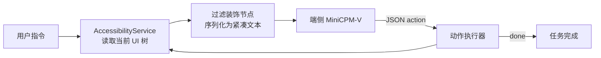

# 智控先锋 · On-device Mobile GUI Agent

> 端侧手机 GUI Agent 的概念验证与架构设计。当前阶段：**设计稿**，仓库暂不包含可运行的原型代码。

用一句自然语言完成跨应用任务：无障碍服务读取当前界面，序列化成紧凑 UI 树；端侧 MiniCPM-V 直接输出下一步动作；执行后重新读取界面，循环直到完成。

## Why

跨应用任务（给某人发消息、改设置、填表）通常要十几次点击、切换 2–3 个 App。云端 Agent 能理解意图，但延迟高、断网不可用，屏幕数据上云也有隐私风险。

这个项目想验证另一条路线：**模型放在端侧，界面用 UI 树而不是截图，单模型直接决策**。

## Architecture



### 一次决策的输入 / 输出

UI 树序列化后的片段：

```text
[0] 按钮 "发送" clickable id=send_btn bounds=(320,1200,480,1280)
[1] 输入框 "输入消息" editable id=msg_input bounds=(60,1100,900,1180)
[2] 文本 "微信" id=title bounds=(400,80,600,140)
```

模型输出：

```json
{"action": "click", "target": 0, "reason": "发送按钮"}
{"action": "input", "target": 1, "text": "周五会议改到下午三点"}
{"action": "done"}
```

## Design decisions

| 选择 | 原因 |
| --- | --- |
| UI 树而不是截图 | 省掉视觉编码，延迟更低；控件坐标精确，动作可直接落到元素 |
| 单 VLM 同时做理解与决策 | 去掉独立动作预测模块，一人可独立完成原型 |
| Q4_K_M 量化 | 模型约 1.6 GB，目标在 6 GB RAM 中端机上运行 |
| 最多 10 步 | 控制单次任务的时延与失控风险 |
| 关键操作二次确认 | 发送、支付、删除等动作需要用户确认，全程可回溯 |
| 全流程端侧 | 屏幕与指令不出终端；断网可完成基础任务 |

> 以上是设计目标，尚未在真机上实测。

## Roadmap

| 阶段 | 内容 | 验收 |
| --- | --- | --- |
| 1. 环境与基线 | 跑通 MiniCPM-V Android Demo，测加载时间、推理延迟、内存 | 目标机型能完成一次图文推理 |
| 2. 感知与理解 | 无障碍服务提取 UI 树并序列化；接入 VLM，输出合法动作 JSON | 能拿到当前界面并让模型输出动作 |
| 3. 闭环与场景 | 动作执行器 + 循环控制；跑 1–2 个完整场景 | 任务能跑通，记录成功率与延迟 |

## 仓库内容

- `README.md`：项目概览与设计取舍
- [`docs/design.md`](docs/design.md)：感知 / 理解 / 执行三段式设计、动作协议、评测计划与风险

## Status

概念验证阶段。仓库里是设计与计划，不是已完成的 App；原始比赛计划书（市场、定价、团队）未包含。

## Disclaimer

项目涉及无障碍服务与屏幕内容，实际落地需要处理隐私合规、权限告知与用户确认；请在合法合规的前提下使用。
